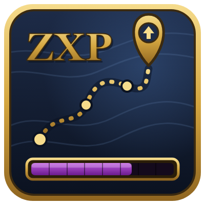

# ZoneXP Advisor

**Where should I level right now?** ZoneXP Advisor looks at your current XP, your quest log and the quests you have already completed, then ranks the zones where you will gain the most experience — and estimates how long it will take.

Built for **World of Warcraft Forever** (Interface 16001). Works for both **Alliance** and **Horde**.

> **Beta:** numbers are estimates — please report anything that looks off in [Issues](../../issues).

[한국어 설명은 아래에 있습니다 ↓](#한국어)

## Download

- **[Latest release](../../releases/latest)** — download `ZoneXPAdvisor-x.y.z.zip`
- Also on CurseForge (after review)

### Install

1. Download the zip from the latest release.
2. Extract it into `World of Warcraft\_forever_\Interface\AddOns\` so that you get `AddOns\ZoneXPAdvisor\ZoneXPAdvisor.toc`.
3. Restart the game (a `/reload` does not pick up new addon folders).

## Features

- **Zone ranking** — top zones by estimated XP, counting quests to turn in, in progress, available now, unlocked by a prerequisite or within 1–2 levels. Completed, grey, repeatable, holiday, battleground, profession, dungeon and other-faction quests are skipped.
- **Quest XP + kill XP** — quest rewards scaled with the classic XP rules, plus XP from the mobs your quests require (item drops estimated from drop rates). Kill XP follows the classic formula: level difference, grey = 0, elites ×2.
- **Optimized quest route** — a precedence-aware route (pick up → objectives → turn in, chains in order) built with nearest-neighbour + 2-opt, with travel, fighting and talking time and **XP per hour**.
- **Measured kill time** — your own pace from the time between kills in the same zone (median of the last 60, used after 20). Kills come from the game's death events; WoW Forever blocks the full combat log for addons, so it is not used.
- **Hunting-ground rating** — good / fair / sparse, from non-elite mobs at your level.
- **UI** — XP bar with rested XP, rank badges, difficulty-colored levels, progress bars, current-zone highlight, sort by total XP or XP per hour, Auto / Alliance / Horde view.
- **Minimap button** — left-click: window, right-click: settings, Shift + left-click: switch sort, drag: move. Also in the addon compartment.
- **Settings** — General, Kill time and About tabs.

## Commands

| Command | What it does |
|---|---|
| `/zxp` or `/levelzone` | Open / close the window |
| `/zxp config` | Open settings |
| `/zxp killtime` | Show kill-time status (`/zxp killtime reset` clears it) |
| `/zxp minimap` | Show / hide the minimap button |
| `/zxp reset` | Move the window to the center |
| `/zxp debug` | Print data-source status (for bug reports) |

## Requirements

- **QuestieDB** (recommended, installed with Questie): quest, NPC and drop data are read at runtime through its public API. No QuestieDB data is bundled.
- Without it, only the quests in your quest log are counted.

ZoneXP Advisor is an independent project and is not affiliated with or endorsed by the Questie team.

## Support

If you enjoy the addon, you can support development on Ko-fi (link coming soon). Donations are optional and unlock nothing.

## License

[GPL-3.0](LICENSE)

---

## 한국어

**지금 어디서 레벨업해야 할까?** ZoneXP Advisor는 현재 경험치, 퀘스트 로그, 이미 완료한 퀘스트를 바탕으로 경험치를 가장 많이 얻을 수 있는 지역의 순위를 매기고, 시간이 얼마나 걸릴지도 알려줍니다. **WoW 포에버**(Interface 16001)용이며 얼라이언스와 호드 모두 지원합니다.

### 설치

1. **[최신 릴리스](../../releases/latest)**에서 `ZoneXPAdvisor-x.y.z.zip`을 받습니다.
2. `World of Warcraft\_forever_\Interface\AddOns\`에 압축을 풀어서 `AddOns\ZoneXPAdvisor\ZoneXPAdvisor.toc`가 되도록 합니다.
3. 게임을 다시 시작합니다. (`/reload`로는 새 애드온 폴더를 읽지 않습니다.)

### 기능

- **지역 순위**: 완료 보고, 진행 중, 지금 받을 수 있는 퀘스트, 선행 퀘스트 뒤에 열리는 퀘스트, 1~2레벨 뒤 퀘스트를 계산합니다. 완료/회색/반복/축제/전장/전문기술/던전/다른 진영 퀘스트는 제외합니다.
- **퀘스트 + 처치 경험치**: 클래식 규칙으로 보상을 조정하고, 퀘스트 목표 몬스터의 경험치도 더합니다. 아이템 목표는 드롭률로 처치 수를 계산합니다.
- **최적 퀘스트 동선**: 받기 → 목표 → 보고 순서를 지키는 경로를 최근접 이웃 + 2-opt로 계산하고, 소요 시간과 **시간당 경험치**를 보여줍니다.
- **전투 시간 실측**: 같은 지역 처치 간격의 중앙값(최근 60마리, 20마리부터 적용). 게임의 사망 이벤트로 감지하며, 포에버는 전투 로그를 막기 때문에 전투 로그는 쓰지 않습니다.
- **사냥터 등급**: 내 레벨의 일반 몬스터 수로 좋음 / 보통 / 적음
- **미니맵 버튼**: 왼쪽 클릭 창, 오른쪽 클릭 설정, Shift + 왼쪽 클릭 정렬 전환, 드래그 이동
- **설정 창**: 일반 / 전투 시간 / 정보 탭

### 명령어

`/zxp` 창 열기 · `/zxp config` 설정 · `/zxp killtime` 전투 시간 상태 · `/zxp minimap` 미니맵 버튼 · `/zxp reset` 창 위치 초기화 · `/zxp debug` 버그 제보용 정보

### 필요 조건

**QuestieDB**(권장, Questie와 함께 설치됨)의 공개 API로 데이터를 읽습니다. 이 애드온에는 QuestieDB 데이터가 포함되어 있지 않으며, Questie 팀과 관련이 없습니다.

버그나 이상한 추천은 [Issues](../../issues)에 레벨, 직업, 진영, 지역, `/zxp debug` 결과와 함께 남겨주세요.
